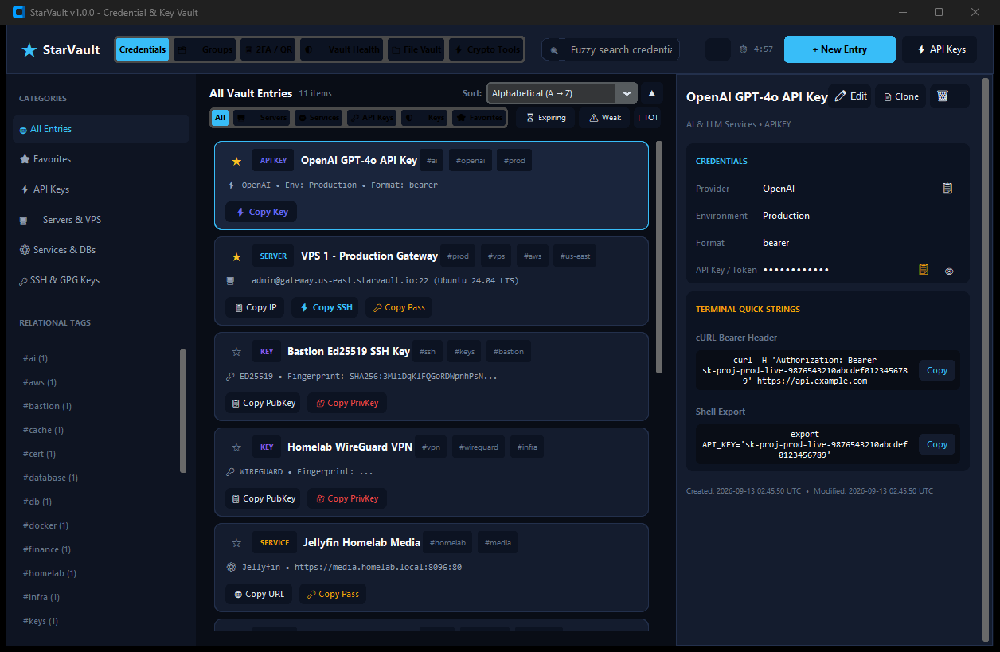
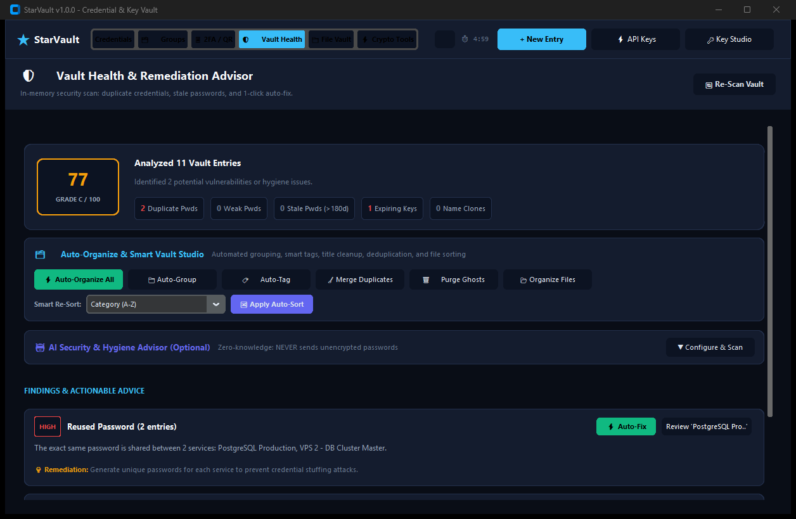
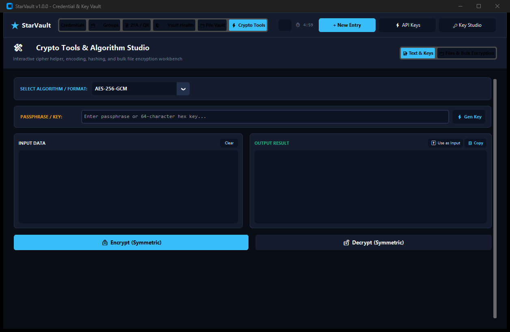
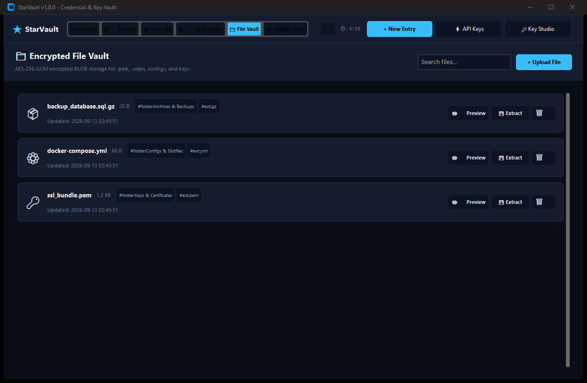
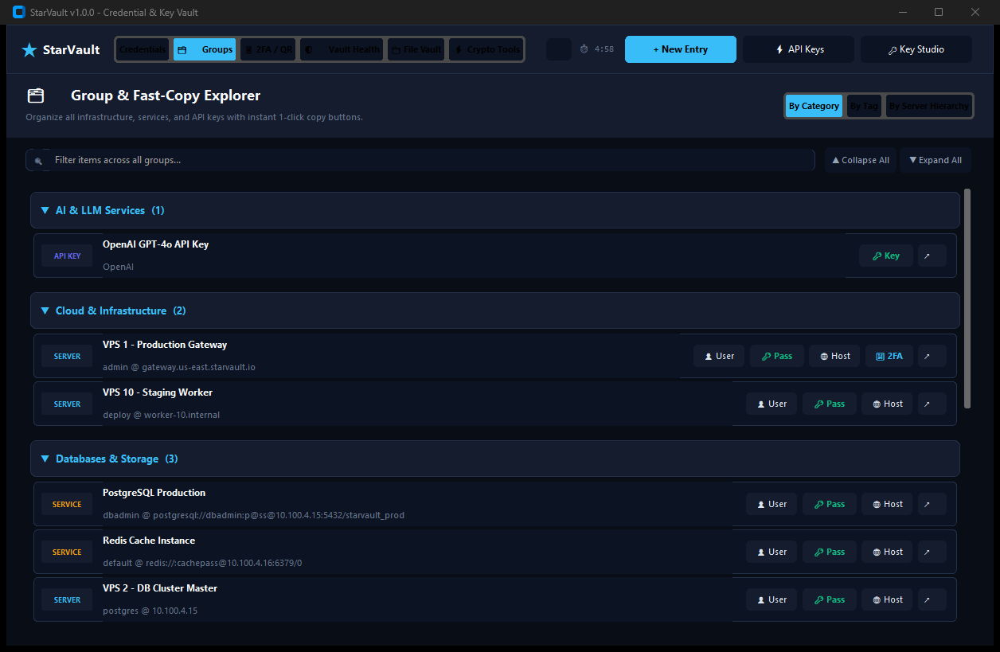
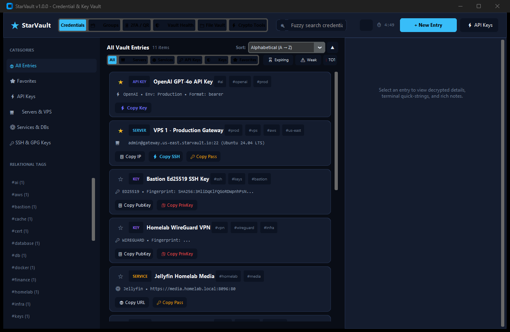

# StarVault ★

> **A modern, zero-knowledge desktop credential vault, cryptographic workbench, and infrastructure key manager designed for homelabs, VPS instances, cloud services, and software engineers.**

Built with **Python**, **CustomTkinter**, **Argon2id**, **AES-256-GCM**, and **SQLite**. Includes a dedicated **Chromium Browser Companion Extension** (Chrome, Brave, Edge) and an integrated **Model Context Protocol (MCP) Server** for AI pair programmers.

---

## 📸 Screenshots Gallery

| 🖥️ Main Dashboard: Sorting, Filters & Quick-Strings | 🛡️ Vault Health Advisor & Auto-Organize Studio |
| :---: | :---: |
|  |  |

| ⚡ Universal Crypto Tools & Certificate Studio | 📁 Encrypted File Vault (BLOB Storage) |
| :---: | :---: |
|  |  |

| 🗂️ Groups, Hierarchy & Relational Tags | 📟 Console (Matrix Green) Theme |
| :---: | :---: |
|  |  |

---

## 🌟 Key Features

### 🗂️ Multi-Group & Multi-Service Organization
- **Multi-Group Assignment**: A single vault entry can belong to multiple groups or organizational categories simultaneously (e.g. `Infrastructure`, `DevOps`, `Production`).
- **Multi-Service Association**: Entries can be mapped to multiple internal/external services (e.g. `SSH`, `WireGuard`, `Prometheus-Exporter`, `Keycloak`).
- **Zero-Knowledge Multi-Tagging**: Groups and services are encrypted inside the AES-256-GCM zero-knowledge payload while remaining fast-indexed for instant search and grouping.
- **Relational Group Views**: In the Group Explorer, switch between `By Group / Category`, `By Service`, `By Tag`, and `By Server Hierarchy`.
- **Ecosystem Sync**: Fully accessible and manageable via the Desktop GUI, Chromium Extension, and Model Context Protocol (MCP) server.

### 🔍 Main Dashboard: Multi-Dimensional Sorting & Quick Filters
- **Natural Numeric Sorting Engine**: Automatically sorts numbered identifiers in human numerical sequence (`VPS 1` → `VPS 2` → `VPS 10`, rather than alphabetical `VPS 1, VPS 10, VPS 2`).
- **11 Sorting Dimensions**:
  - `Natural Numeric (1, 2, 10...)`
  - `Alphabetical (A → Z)` and `Alphabetical (Z → A)`
  - `Date Created (Newest / Oldest)`
  - `Date Modified (Newest / Oldest)`
  - `Category (A → Z)`
  - `Security Risk (Highest Risk First)`
  - `Entry Type (Servers, Services, API Keys, Keys)`
  - `Port Number (Numeric Order)`
  - `Password Length`
- **Instant Direction Toggle**: Quick `▲ / ▼` button to invert any sorting criterion.
- **Quick-Filter Toolbar**:
  - **Type Segmented Selector**: `All`, `🖥️ Servers`, `🌐 Services`, `🔑 API Keys`, `🛡️ Keys`, `⭐ Favorites`.
  - **Status Filter Chips**: `⏳ Expiring` (items expiring within 30 days), `⚠️ Weak` (passwords < 12 characters), `📱 TOTP` (credentials with 2FA tokens enabled).
  - **✕ Clear Filters Button**: 1-click reset of all active filters, chips, search terms, and category selections.
- **Fuzzy Search**: Blazingly fast fuzzy string matching (`rapidfuzz`) over titles, usernames, hosts, and relational tags.

### 🛡️ Defense-in-Depth Security & True Local 2FA
- **Argon2id Key Derivation**: Derived using RFC 9106 recommended parameters (`m=64MB`, `t=3`, `p=4`, `len=32`).
- **True Local 2FA (QR Code Keyfile)**: Fuses your Master Password with an offline 256-bit random QR Code Keyfile (`keyfile.png`). Unlocking requires both knowledge (Master Password) and possession (physical QR keyfile).
- **AES-256-GCM Field & File Encryption**: All passwords, tokens, private keys, notes, and file BLOBs are encrypted with unique 12-byte random nonces and 16-byte authentication tags.
- **Canary Validation**: Verifies authentication without ever storing plaintext passwords or hashes on disk.
- **In-Memory Protection**: Cryptographic key bytes in memory are zeroed upon lock or exit.
- **100% Offline & Portable**: Single standalone SQLite database (`starvault.db`).

### 🧠 Internal Neural Network Security Engine & Hybrid AI Health Advisor
- **100% Offline & Zero-Knowledge by Default**: Analyzes multi-dimensional credential telemetry entirely in memory using a dedicated local 2-layer perceptron ($12 \to 16 \to 8$) with LeakyReLU activations without transmitting a single byte to external servers.
- **Sub-Millisecond Inference (< 0.5ms)**: Pure vectorized matrix arithmetic evaluates your entire vault in < 1ms with zero heavy GPU/PyTorch dependencies.
- **12-Dimensional Security Vector Analysis**:
  - `length_norm`, `entropy_norm`, `char_variety`, `pattern_cleanliness`, `age_stale_factor`, `expiry_urgency`, `exposure_surface`, `mfa_protection`, `reuse_count_norm`, `group_breadth`, `metadata_completeness`, `key_algorithm_strength`.
- **Tri-Head Neural Outputs**:
  - **Compromise Risk Score (0-100)**: Sigmoid-activated probability of credential vulnerability.
  - **Anomaly Score (0-100)**: Detects anomalous configurations (e.g. unencrypted HTTP with admin privileges and missing 2FA).
  - **6-Class Softmax Classification**: `SECURE_OPTIMAL`, `CRITICAL_EXPIRING`, `WEAK_ENTROPY`, `REUSED_CREDENTIAL`, `STALE_UNROTATED`, `UNPROTECTED_EXPOSURE`.
- **Hybrid AI Architecture**:
  - **Internal Neural Network** is the default, primary security advisor.
  - Optional cloud/local LLM integrations (OpenAI, Anthropic Claude, Google Gemini, Ollama, OpenRouter) can be enabled on demand for natural language prose advice and architectural suggestions.
- **1-Click Neural Scan & Auto-Fix**: Run neural health audits in 1-click and immediately auto-rotate weak passwords, renew expiring tokens, or auto-assign missing groups and services.
- **Full Ecosystem Parity**: Exposed seamlessly across Desktop GUI, Chromium Extension (`/api/neural_health`, `/api/neural_analyze_entry`), and Model Context Protocol (MCP) server.

### 🩺 Traditional Rule-Based Vault Health Scanners
- **Comprehensive Audit**: Calculates an overall vault health score (0–100) and security grade (A through F).
- **Vulnerability Scanners**:
  - Reused / duplicate passwords across servers and services.
  - Weak passwords with low entropy (< 40 bits) or short length (< 12 chars).
  - Accidental duplicate names (fuzzy name matching).
  - Stale credentials unrotated for > 180 or 365 days.
  - Expiring TLS certificates, API tokens, and licenses.
- **One-Click Remediation**: Click "Review" on any finding to jump directly to the credential inspector.

### ✨ Smart Auto-Organize & Deduplicate Studio
- **Intelligent Classification**: Automatically categorizes credentials into `Cloud & Infrastructure`, `Dev & Repositories`, `Databases & Storage`, `AI & LLM Services`, `Finance & Payments`, `Security & Networking`, `Work & Productivity`, and `Personal & Entertainment`.
- **Automated Tag Generation**: Infers and assigns relational tags based on protocols, domains, environments, and services (e.g. `#vps`, `#docker`, `#prod`, `#postgres`, `#ai`).
- **Title Normalization**: Standardizes casing, trims redundant prefixes, and cleans titles across the vault.
- **Smart Deduplication & Merge**: Consolidates redundant credentials, automatically merging custom fields, unique notes, and tags without losing data.
- **Ghost & Stale Detection**: Identifies and safely cleans empty records or orphaned child credentials.

### ⚡ Universal Crypto Tools & Key / Cert Studio
- **Cryptographic Workbench**:
  - **Symmetric Encryption & Decryption**: Text & file encryption with AES-256-GCM. Features `📂 Load File into Input...` (supports UTF-8 text, ASCII armor, or binary converted to Base64), `💾 Save Output to File...`, and 1-click direct file encryption/decryption (`.enc`).
  - **Interactive File Encryption Queue**: Batch-encrypt and decrypt multiple files or entire folder trees with an interactive queue showing individual file sizes, remove buttons (`✕`), clear queue, alongside vs custom folder output destinations, and real-time progress.
  - **Cryptographic Hashes**: SHA-256, SHA-512, MD5, and HMAC-SHA256.
  - **Data Encoders**: Base64 Encode/Decode, Hex Encode/Decode, URL Encode/Decode.
  - **UUID & Entropy**: Cryptographically secure UUID v4 generation.
- **Key & Certificate Generation Studio & Key Studio**:
  - **Ed25519 Keypairs**: Modern 256-bit elliptic curve SSH keys with OpenSSH and PuTTY (`.ppk`) export support.
  - **WireGuard VPN Keypairs**: X25519 public/private keys for VPN tunnels (`.wg.pub` / `.wg.key`).
  - **Self-Signed X.509 TLS/SSL Certificates**: Custom Common Names (CN), Subject Alternative Names (SANs), RSA / ECDSA / Ed25519 keys, and configurable validity periods (`.crt` / `.key`).
  - **RSA-4096 & GPG / OpenPGP / Age**: High-security RSA, armored OpenPGP keypairs (`.asc`), and modern Age encryption keys (`.recipient.txt` / `.key`).
  - **Direct Vault Storage**: 1-click button to save newly generated keys and certificates straight into your encrypted database keyring.
  - **Local PC File & Bundle Export**: Save individual public keys / certs or private keys straight to your computer with automatic file extension matching, or export both simultaneously via `📦 Export Keypair Bundle to Folder...`.

### 🌐 Domain & URL Management & Relational Hierarchy
- **Dedicated Domain Tracking**: First-class `domain` entry type tracking domain names/URLs, registrar ("who I bought it from"), registrar account credentials (username/email, encrypted password with 1-click password generator & show/hide toggle, and 2FA TOTP secrets), expiry dates, registration dates, renewal costs, auto-renewal toggles, DNS management providers, nameservers, and encrypted EPP/transfer authorization codes.
- **Quick Expiration Presets**: Instant `+1 Yr`, `+2 Yrs`, and `+5 Yrs` calculation buttons in the Domain Entry Dialog for fast renewal logging.
- **Relational Domain Hierarchy (`parent_domain_id`)**: Attach any vault entry (servers, services, databases, API keys, SSL/TLS certificates) to a parent domain to represent full project, brand, or infrastructure stacks.
- **Inspector Attached Items Table**: View all child entries linked to a domain in a dedicated, interactive table with 1-click secret copying and a `+ Attach Item` shortcut.
- **High-Speed Explorer & HUD**: Filter by `🌐 Domains & URLs` in the sidebar and dashboard type pills, group by `By Domain / URL` in the Groups Explorer, and access domain URLs, registrars, and auth codes in the Quick Search HUD.
- **Chromium Browser Extension Companion**: Native domain tracking chip (`🌐 Domains`), 1-click domain copying, registrar password reveal/copy, domain saving mode, and parent domain attachment directly inside the browser popup.
- **Proactive Health & Expiry Audits**: Flags expired or soon-to-expire domains with countdowns, auto-renewal status, and registrar details in the Vault Health Advisor.
- **Zero-Knowledge Backup & Ecosystem Parity**: Full support across `.sve` portable export containers, SQLite migrations, Browser Extension loopback bridge, and MCP server tools.

### 🕒 Zero-Knowledge Credential Versioning, Rollbacks & Retention
- **Automatic Rotation Snapshots**: Whenever sensitive credentials (passwords, SSH/GPG keys, API tokens, TOTP secrets) are rotated, StarVault immediately captures an encrypted zero-knowledge version snapshot.
- **Cryptographic Fingerprinting**: Distinguishes authentic secret rotations from non-sensitive metadata edits (e.g. tag or folder updates) to maintain an uncluttered version timeline.
- **Interactive Timeline & Visual Diff**: The dedicated **Version History Studio** displays snapshot timelines, descriptive change summaries, decrypted credential reveals, and side-by-side field comparisons vs current live entries.
- **1-Click Rollback with Pre-Rollback Guard**: Instantly revert any credential or keypair to a previous historical version. StarVault automatically preserves a pre-rollback snapshot before restoring so you can always undo.
- **Physical Key Lifecycle Management**: Links physical key files (`.pem`, `.pub`, `.ppk`, `.key`, `.crt`, `.asc`) in StarVault's dedicated keys directory to version snapshots. When versions are deleted, associated physical files can be securely overwritten with random bytes and unlinked.
- **Configurable Retention Policies**: Configure automated pruning rules in Settings by maximum age (days, months, years) and max versions per entry. Run on-demand cleanups or dry-run simulations with zero risk.
- **Full Ecosystem Parity**: Manage version histories and rollbacks via Desktop GUI inspector, Chromium Extension bridge (`/api/entry_versions`, `/api/restore_version`, `/api/clean_versions`), and MCP server tools.

### 🌐 Chromium Browser Companion Extension (Chrome, Brave, Edge)
- **Localhost Loopback Bridge**: Runs securely on `127.0.0.1:8088`; credentials never leave your machine.
- **1-Click Auto-Fill**: Injects username and password directly into web forms matching the active tab.
- **Natural Numeric Sorting & Quick Filters**: Search and sort your entire vault from the browser toolbar.
- **In-Browser Key & Secret Studio**: Generate passwords, API keys, Ed25519 keys, and WireGuard keys right in your browser.
- **Crypto & TLS Studio**: Calculate hashes, encode/decode, or generate self-signed certificates on the fly.
- **Smart Auto-Organize Trigger**: Trigger auto-categorization and duplicate merging from the extension.
- **Master Password Protected CSV Export**: Download a sanitized CSV export directly from the extension upon master password authentication.
- **Multi-Theme Switcher**: Matches your desktop theme (Modern Dark, Midnight Blue, Matrix Console Green, Cyberpunk Neon, Clean Light).

### 📦 Universal Vault Export & Migration Container (.sve / .zip / .csv)
- **Zero-Knowledge Encrypted Package (`.sve` / `.starvault`)**:
  - Secure, self-contained portable vault container designed for zero-knowledge backup and seamless cross-machine migration.
  - Header with `STV1` magic identifier, 16-byte Argon2id salt (`t=3, m=64MB, p=4`), 12-byte AES-256-GCM nonce, 16-byte authentication tag, and zlib-compressed encrypted payload.
  - Complete zero-knowledge payload captures all credentials, custom fields, tags, groups, physical & encrypted keyring files, attached file BLOBs, and rotation version snapshots.
  - Easily imported by any other StarVault instance with passphrase protection.
- **Universal Import Engine & Interactive Wizard**:
  - Dedicated `VaultImportDialog` with pre-import inspection preview (counts of entries, keys, files, and version snapshots).
  - Three collision resolution strategies:
    - `Skip Conflicting Records`: Preserves existing entries, importing only new records.
    - `Overwrite Existing Records`: Updates matching records with incoming data.
    - `Create New Renamed Copies`: Clones conflicting items with a timestamped suffix (`- Imported <Timestamp>`).
  - Supports `.sve`, `.starvault`, structured `.zip` archives, and plaintext `.csv`.
- **Structured Archive Export (`.zip`)**:
  - Exports credentials CSV, decrypted files, private/public keys, certificates, and an audit `manifest.json`.
- **Sanitized CSV Spreadsheet Export**:
  - Neutralizes spreadsheet formula injection (DDE attacks) by escaping formula triggers (`=`, `+`, `-`, `@`).
- **Quick Access**: Available directly from the top navigation bar (`📤 Export`, `📥 Import`) and the Settings Dialog storage card.

### 📁 Encrypted File Vault (BLOB Storage)
- **Arbitrary File Storage**: Securely store `.pem`, `.ovpn`, `docker-compose.yml`, `.env`, and backup files.
- **AES-256-GCM BLOB Encryption**: Encrypted at rest in SQLite using the vault master key.
- **In-Memory Previewer & Extraction**: View configuration files in-memory or extract decrypted files back to disk.

### 🤖 Model Context Protocol (MCP) Server
StarVault exposes an integrated MCP server for seamless integration with AI coding assistants (Claude Desktop, Antigravity, Cursor, etc.):
- `search_credentials`, `get_credential`, `save_credential`, `lock_vault`, `get_vault_health`
- `auto_organize_vault`, `deduplicate_vault`, `sort_vault_entries`
- `crypto_hash`, `crypto_encrypt`, `crypto_decrypt`, `crypto_encode`, `crypto_decode`
- `generate_keypair`, `generate_tls_cert`, `export_vault_csv`
- `starvault_get_entry_versions`, `starvault_restore_entry_version`, `starvault_clean_old_versions`

---

## 🎨 Themes & Customization

StarVault features 5 handcrafted color themes:
1. **Modern Dark** (Default): Sleek slate & electric cyan interface.
2. **Midnight Blue**: Deep navy palette tailored for nocturnal engineering.
3. **Console (Matrix Green)**: High-contrast phosphor terminal aesthetic.
4. **Cyberpunk Neon**: Vivid magenta and electric violet synthwave theme.
5. **Clean Light**: High-legibility daylight theme for bright office environments.

---

## 🚀 Running StarVault

### Standalone Executable (Windows)
- Double-click `StarVault.exe` in the project root or in `dist/StarVault.exe`.
- **Zero console window**: Runs cleanly with custom icon embedding without popping up a command prompt.
- **Portable mode**: Place `starvault.db` in the same directory to run in fully portable mode.

### Running from Source
```powershell
# 1. Clone repository
git clone https://github.com/YOUR_USERNAME/StarVault.git
cd StarVault

# 2. Set up virtual environment
python -m venv .venv
.\.venv\Scripts\Activate.ps1

# 3. Install dependencies
pip install -r requirements.txt

# 4. Launch StarVault
python run.py
```

### Launch Flags
- **Default Mode** (uses `%LOCALAPPDATA%\StarVault\starvault.db`): `python run.py`
- **Portable Mode** (uses `./starvault.db` in working directory): `python run.py --portable`
- **Custom Database**: `python run.py --db "D:/Secure/vault.db"`

---

## 🧩 Installing the Browser Extension

1. Open your Chromium browser's extensions management page:
   - **Brave**: `brave://extensions`
   - **Chrome**: `chrome://extensions`
   - **Edge**: `edge://extensions`
2. Enable **Developer mode** (toggle switch in the top-right corner).
3. Click **Load unpacked** and select the `extension/` directory.

---

## ⌨️ Global Keyboard Shortcuts

| Shortcut | Action |
|---|---|
| `Ctrl + C` | Copy Password of selected entry (30-second clipboard wipe) |
| `Ctrl + U` | Copy Username of selected entry |
| `Ctrl + B` | Copy Host, URI, or IP address of selected entry |
| `Ctrl + D` | Duplicate selected entry (clones with `- Copy` title) |
| `Ctrl + F` | Focus central search bar |
| `Ctrl + L` | Immediately lock vault and wipe session keys |
| `Esc` | Close HUD search window / Dismiss active dialogs |
| `Up / Down` | Navigate search results in floating HUD |
| `Enter` | Copy primary credential in HUD |

---

## 🧪 Testing

StarVault includes a comprehensive automated test suite with **100% pass rate** (81 test cases):

```powershell
.\.venv\Scripts\pytest tests/ -v
```

---

## 🔒 Cryptographic Specifications

| Component | Specification |
|---|---|
| Key Derivation Function (KDF) | Argon2id (`t=3`, `m=64MB`, `p=4`, `len=32`) |
| Salt | Cryptographically secure random 16 bytes per database |
| Cipher | AES-256-GCM (Galois/Counter Mode) |
| Nonce / IV | 12 bytes cryptographically secure random per field |
| Authentication Tag | 16 bytes authentication tag per field |
| Asymmetric Ciphers | Ed25519 (SSH), X25519 (WireGuard), RSA-4096, PGP |
| Certificate Engine | X.509 Self-Signed TLS with SAN extension support |
| In-Memory Protection | Zeroized upon lock or application termination |
| Clipboard Sanitization | Automatic 30-second wipe for all copied secrets |
